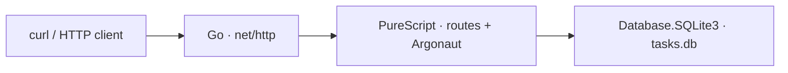

# 📝 Task list API

**PureScript logic. Native Go HTTP. Persistent SQLite storage.**

Create a task, tick it off, restart the server: your data is still there.
This example takes a PureScript application all the way to a native Go
executable, with a JSON API you can explore from your terminal.

- **PureScript application code** — routing, validation, JSON and database queries.
- **SQLite persistence** — a local database file, parameterized SQL and no database server to set up.
- **Typed Go FFI** — request/response records and callbacks connect PureScript to Go's `net/http`.
- **Argonaut JSON** — decode request bodies into typed records and encode responses.
- **Graceful shutdown** — finish application callbacks before closing the database, including on Aff cancellation.

[Build and run](#build-and-run) · [Try the API](#try-the-api) ·
[Read the code](#read-the-code) · [Configuration](#configuration) · [Tests](#verify)

## Build and run

You'll need Node.js, Go, Spago, the matching
[typed PureScript frontend](../../docs/nix.md#typed-frontend-and-development-shell),
and a built gopurs compiler with its sibling Go library ports.
For a fresh checkout, follow the [bootstrap guide](../../docs/bootstrap.md)
and its [library setup instructions](../../docs/bootstrap.md#native-bootstrap).

From the gopurs repository root:

```sh
cd examples/task-list-api
node tools/build.mjs
./.build/task-list-api
```

```text
LISTENING http://127.0.0.1:8080
```

The server creates `tasks.db` in the current directory. Leave it running and
open another terminal for the walkthrough below. Ctrl-C stops the server and
closes SQLite; a clean shutdown prints `STOPPED`.

<details>
<summary>Checkout layout and build details</summary>

The build uses sibling library checkouts:

```text
workspace/
  gopurs/
    examples/task-list-api/
  gopurs-aff/
  gopurs-strings/
  ...other Go library ports...
  gopurs-sqlite3/
```

`GOPURS_PURS` selects the typed frontend explicitly; otherwise the build uses
gopurs's normal local discovery. `GOPURS_COMPILER_ROOT` and `GOPURS_LIBRARY_ROOT`
override the default compiler and sibling library paths.

The build script copies library sources into a private temporary workspace,
compiles the PureScript application, prepares pinned Go dependencies, generates
Go and builds `.build/task-list-api`. Logs and a build description are kept in
`.build/`. Library checkout outputs are left untouched.

Set `GOPURS_OFFLINE=1` for an already cached Spago graph; Go dependency
preparation still needs its pinned module cache or access to the Go module
proxy. `GOPURS_TEST_KEEP_WORKSPACE=1` retains the temporary workspace for
inspection.

</details>

## Try the API

Start with a health check:

```sh
API=http://127.0.0.1:8080
curl -sS "$API/health"
```

```json
{"status":"ok"}
```

The responses below assume a new database and are formatted for readability.

### 1. Create a task

```sh
curl -sS "$API/tasks" \
  -H 'Content-Type: application/json' \
  -d '{"title":"Ship my first PureScript API"}'
```

**201 Created**

```json
{
  "id": "1",
  "title": "Ship my first PureScript API",
  "completed": false
}
```

Use the ID returned by your request for the remaining steps:

```sh
TASK_ID=1
```

IDs are decimal **strings**, preserving the precision of SQLite's 64-bit rowids
when the JSON is consumed by JavaScript clients.

### 2. List your tasks

```sh
curl -sS "$API/tasks"
```

**200 OK** — tasks are ordered by ID.

```json
[
  {
    "id": "1",
    "title": "Ship my first PureScript API",
    "completed": false
  }
]
```

Fetch just that task with `curl -sS "$API/tasks/$TASK_ID"`.

### 3. Mark it complete

```sh
curl -sS -X PATCH "$API/tasks/$TASK_ID" \
  -H 'Content-Type: application/json' \
  -d '{"completed":true}'
```

**200 OK**

```json
{
  "id": "1",
  "title": "Ship my first PureScript API",
  "completed": true
}
```

Send `false` to reopen the task. PATCH updates the completion flag only.

**Try the persistence:** stop the server with Ctrl-C, run
`./.build/task-list-api` again from the same directory, then fetch the task.
It is still there, still completed.

### 4. Delete it

```sh
curl -i -X DELETE "$API/tasks/$TASK_ID"
```

**204 No Content** — an empty response body. Fetching the deleted task returns
**404 Not Found**:

```json
{"error":"Task not found"}
```

### Endpoints at a glance

| Method | Path | Request body | Success |
| --- | --- | --- | --- |
| `GET` | `/health` | — | `200` · `{"status":"ok"}` |
| `GET` | `/tasks` | — | `200` · array of tasks |
| `POST` | `/tasks` | `{"title":"..."}` | `201` · created task |
| `GET` | `/tasks/:id` | — | `200` · task |
| `PATCH` | `/tasks/:id` | `{"completed":true}` | `200` · updated task |
| `DELETE` | `/tasks/:id` | — | `204` · no body |

### Validation and errors

Titles are trimmed and must contain 1–200 UTF-16 code units. Try a blank title:

```sh
curl -i "$API/tasks" \
  -H 'Content-Type: application/json' \
  -d '{"title":"   "}'
```

**400 Bad Request**

```json
{"error":"Title must contain 1 to 200 UTF-16 code units"}
```

| Situation | Status | Response |
| --- | --- | --- |
| Invalid JSON or missing/non-string `title` on POST | `400` | `{"error":"Expected a JSON object with a string title"}` |
| Missing/non-boolean `completed` on PATCH | `400` | `{"error":"Expected a JSON object with a boolean completed"}` |
| Task does not exist | `404` | `{"error":"Task not found"}` |
| Unknown route or invalid ID, such as `/tasks/abc` | `404` | `{"error":"Route not found"}` |
| Unsupported method on a valid `/tasks/:id` route | `405` | `{"error":"Method not allowed"}` |
| Request body larger than 64 KiB | `413` | Plain-text rejection by the HTTP transport |
| Application error | `500` | `{"error":"Internal server error"}`; details logged on the server |

## Read the code

The request enters through Go, while the application decisions live in
[Main.purs](src/Main.purs):



### A task is a PureScript record

```purescript
type Task = { id :: String, title :: String, completed :: Boolean }
type NewTask = { title :: String }
type UpdateTask = { completed :: Boolean }
```

Argonaut decodes POST and PATCH bodies into `NewTask` and `UpdateTask`.
The handler validates the input, runs the query and encodes the response.

### SQL stays beside the application logic

The create handler binds the title as a parameter, then uses the insert result
to return the new task:

```purescript
result <- SQLite.execute database "INSERT INTO tasks (title) VALUES (?)" [ unsafeToForeign title ]
pure $ json 201 { id: result.lastInsertRowId, title, completed: false }
```

### The HTTP boundary is typed

The transport passes these records and a reply callback through
[gopurs's ordinary Go FFI](../../docs/ffi-idiomatic.md):

```purescript
type Request = { method :: String, path :: String, body :: String }
type Response = { status :: Int, body :: String }

serve :: String -> (Request -> (Response -> Effect Unit) -> Effect Unit) -> Aff Unit
```

| File or library | What to explore |
| --- | --- |
| [Main.purs](src/Main.purs) | Routes, validation, JSON responses, parameterized SQL and database lifetime. |
| [HTTP.purs](src/Example/HTTP.purs) | Typed callbacks and the server's acquisition/release bracket. |
| [HTTP.go](src/Example/HTTP.go) | Native sockets, body limits, signals and draining handlers during shutdown. |
| [gopurs-sqlite3](https://github.com/0x000000000000000000001/gopurs-sqlite3) | SQLite operations, transactions and database resource management. |

## Configuration

| Environment variable | Default | Purpose |
| --- | --- | --- |
| `TASK_LIST_ADDRESS` | `127.0.0.1:8080` | Listening address; use `127.0.0.1:0` to select an available port. |
| `TASK_LIST_DATABASE` | `tasks.db` | SQLite database path; reuse it to keep tasks across restarts. |

For example, from this example directory:

```sh
TASK_LIST_ADDRESS=127.0.0.1:9000 TASK_LIST_DATABASE=./demo.db ./.build/task-list-api
```

The server prints its actual address in the `LISTENING` line. Update `API` in
your client terminal if you change the port.

## Verify

From this example directory:

```sh
node tools/build.mjs --race
node --test test/http.test.mjs
node --test test/cancellation.test.mjs
go test -race -count=1 ./src/Example
```

| Check | What it exercises |
| --- | --- |
| [HTTP integration tests](test/http.test.mjs) | The compiled application: CRUD, JSON validation, parameterized SQL, concurrent insertion IDs, persistence across restart, SIGTERM shutdown and startup failures. |
| [Aff cancellation tests](test/cancellation.test.mjs) | A separately compiled fixture: canceling the server with connected and disconnected clients, waiting for the handler before releasing resources and returning from `killFiber`, under Go's race detector. |
| [Go transport tests](src/Example/HTTP_test.go) | Body limits, duplicate callbacks and draining application work after a client disconnects. |

Use `node tools/build.mjs --dev --race` for the development profile. Set
`GOPURS_JS=0` to exercise a freshly rebuilt native compiler host.

## Resource lifetime

The transport owns sockets and signals; a PureScript `bracket` owns the server
handle, and the outer `withDatabase` bracket owns SQLite. On shutdown, the
server finishes application callbacks before the database closes.

<details>
<summary>How cancellation and cleanup fit together</summary>

A bracket pairs resource acquisition with release, including when the action
fails or is canceled. Canceling the server's Aff stops waiting, then its release
explicitly stops the server and waits for it to finish before the database can
close. That release is masked: cancellation cannot interrupt it.

Every dispatched request must invoke its reply callback, including on errors.
The example's `runAff_` handler does so on both outcomes. Long-running application
work can delay shutdown beyond the HTTP grace period; the database is kept open
until that work releases its callback, even if the client has disconnected.

This example uses a local transport because the existing Node HTTP port has
incomplete server lifecycle operations. No additional HTTPurple port is needed.

</details>
